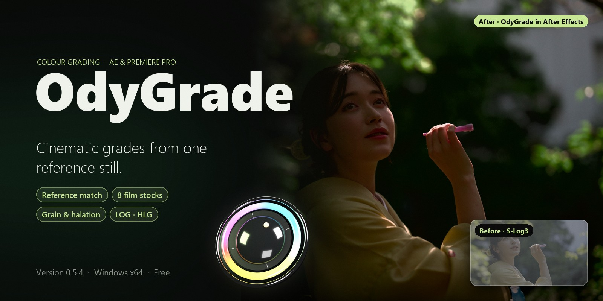
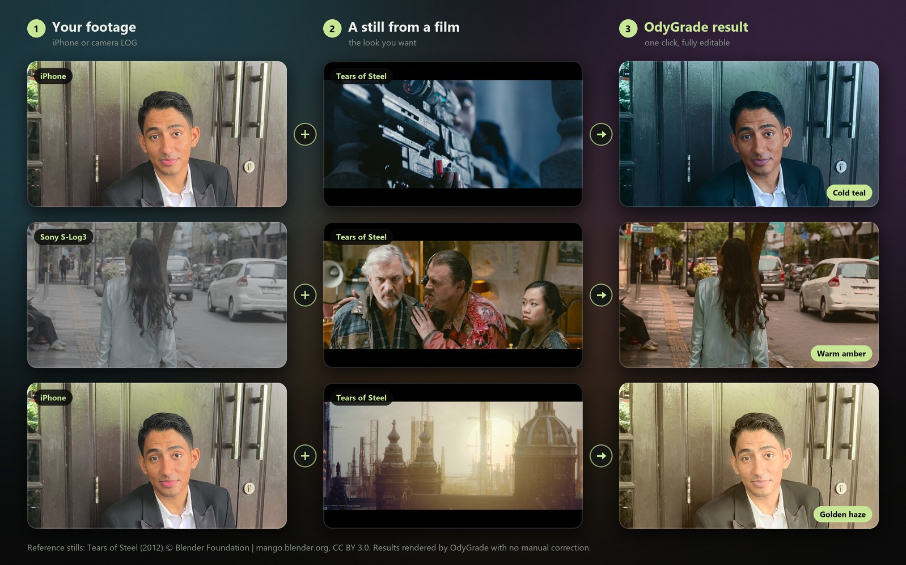
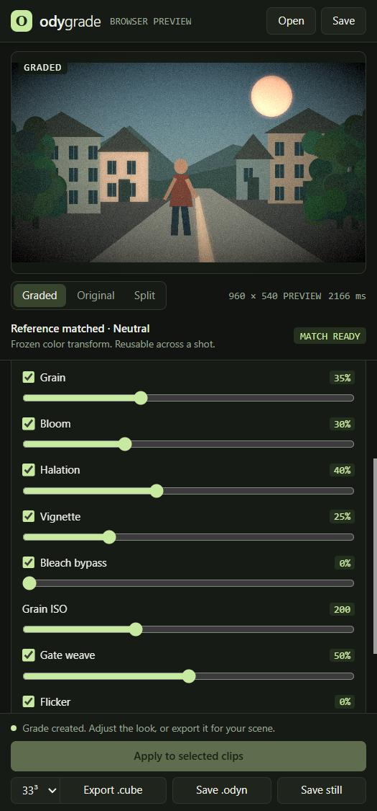
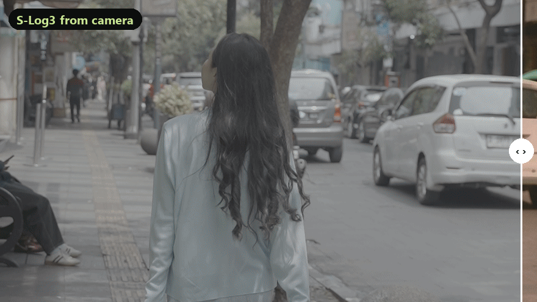
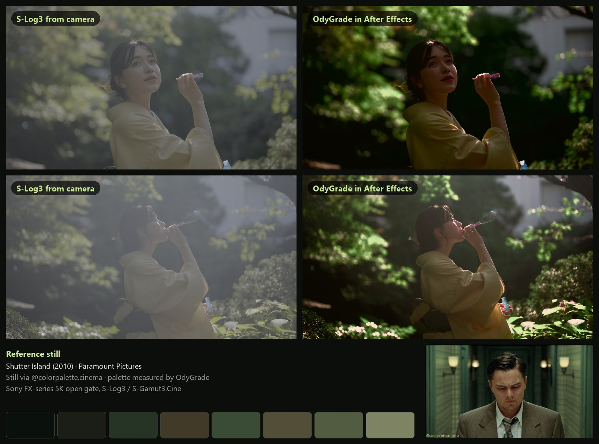
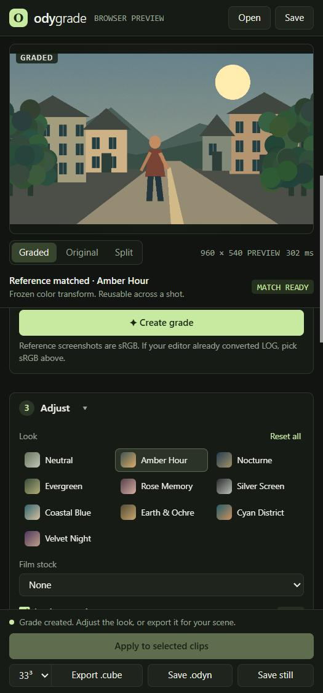

<p align="center"></p>

<p align="center"><a href="https://github.com/jordylf/OdyGrade/releases/latest"><strong>Download for Windows ↗</strong></a> &nbsp; · &nbsp; <a href="#how-it-works">How it works</a> &nbsp; · &nbsp; <a href="#film-texture-in-one-panel">Film texture</a> &nbsp; · &nbsp; <a href="#from-s-log3-to-the-look">S-Log3 demo</a> &nbsp; · &nbsp; <a href="#install-in-three-steps">Install</a> &nbsp; · &nbsp; <a href="#questions">FAQ</a></p>

<p align="center"><sub>REFERENCE GRADING · AFTER EFFECTS & PREMIERE PRO 2024 · WINDOWS</sub></p>

## Cinematic grades from one reference still.

OdyGrade is a colour grading effect that lives on your timeline in After Effects and Premiere Pro. Give it a still whose colour you love, and it builds a grade for your footage that you can keep tweaking. Film stocks, grain, halation and film formats are in the same panel.

**Reference match** &nbsp;·&nbsp; **10 looks** &nbsp;·&nbsp; **8 film stocks** &nbsp;·&nbsp; **Film texture** &nbsp;·&nbsp; **LOG & HLG profiles**

---

<p align="center"><sub>HOW IT WORKS</sub></p>

## How it works

### Love the colour of a still? OdyGrade builds the grade.

1. **Pick your frame.** Capture it from the timeline or drop in one or more stills from the shot.
2. **Pick the reference.** One screenshot of the look you want: a film, an ad, a photo you shot.
3. **Set the camera profile.** sRGB, Rec.709, HLG or one of eight LOG curves, so your colours are read correctly.
4. **Create grade, then apply.** One click matches tone, palette and chroma, colour by colour: greens toward the reference's greens, blues toward its blues. **Apply to selected clips** puts it on every selected layer or clip in one undo step.

The grade is frozen for the whole shot (no frame-to-frame pumping) and embedded in the effect, so it survives save, reopen and render. Every part stays editable.

<p align="center"><br><sub><b>Real demo.</b> Our footage → a still from <i>Tears of Steel</i> → OdyGrade result, no manual correction. One reference, one click.</sub></p>

---

<p align="center"><sub>FILM</sub></p>

## Film texture, in one panel.

Switch on the tools you want, then set them with sliders. They run after the grade, in the same render pass.

<table>
<tr>
<td width="44%"></td>
<td>

- **Grain**: classic, or 8 / 16 / 35 / 65 mm · ISO 50 to 500
- **Bloom & Halation**: light that spreads and glows red
- **Vignette**: darker frame edges
- **Bleach bypass**: low saturation, hard contrast
- **Faded blacks**: lifted shadows
- **Highlight softness**: gentle, filmic roll-off
- **Frame ratio**: 2.39, 1.85 or 1.33 bars, aware of pixel aspect
- **Film format**: Regular 8 to IMAX, with gate weave, flicker, dust and perforations
- **Film stock**: 8 colour responses with an amount slider

</td>
</tr>
</table>

<p align="center"><br><sub><b>Real demo.</b> Same graded S-Log3 frame · Grade only · 35 mm · 16 mm · Super 8 · Bleach bypass · Scope 2.39</sub></p>

<p align="center"><br><sub>Eight stocks with an amount slider: our own colour responses, not copies of any manufacturer's film</sub></p>

---

<p align="center"><sub>BEFORE / AFTER</sub></p>

## Real footage, graded with OdyGrade.

Our own Sony S-Log3 and iPhone footage, straight from the timeline, not a marketing render.

<p align="center"><br><sub>Wipe recorded from real renders · each look matched from one <i>Tears of Steel</i> still, shown in the corner</sub></p>

### From S-Log3 to the look.

A Sony 5K open-gate clip in S-Log3 / S-Gamut3.Cine, straight from the card, graded in After Effects from one film still. OdyGrade reads the camera profile from the clip's metadata, turns the flat LOG image into normal colour and carries over the deep greens and warm skin of the reference.

<p align="center"><br><sub><b>Real demo, rendered in After Effects.</b> Sony S-Log3 → one click, matched to a still from <i>Shutter Island</i> (2010)</sub></p>

---

<p align="center"><sub>THE PANEL</sub></p>

## A simple panel, with sliders that make sense.

<table>
<tr>
<td width="44%"></td>
<td>

Move match strength, exposure, temperature, tint, contrast, saturation and skin protection without leaving the panel. Your camera profile is handled for you.

- Docks beside your timeline in AE and Premiere
- **10 original looks**: Neutral, Amber Hour, Nocturne, Evergreen, Rose Memory, Silver Screen, Coastal Blue, Earth & Ochre, Cyan District, Velvet Night
- **Skin hue protection** keeps faces natural
- **Match skin and background separately**: skin takes the reference's skin tones, the rest takes its palette
- **Save .odyn / Open** to reuse a grade on other shots
- **Export .cube** for a colour-only LUT

</td>
</tr>
</table>

### Works in

| Host | Version | System |
| --- | --- | --- |
| Adobe After Effects 2024 | 24.6 (tested) · 8, 16, 32 bpc · Multi-Frame Rendering | Windows 10/11 x64 |
| Adobe Premiere Pro 2024 | 24.6 (tested) · export through Media Encoder | Windows 10/11 x64 |

**Speed** (1080×1920, full grade with film stock, grain, bloom, halation, weave and dust): After Effects renders 120 frames in **54.4 s** (61.3 s with trims). Premiere exports at **0.26 s per frame**.

---

<p align="center"><sub>INSTALL</sub></p>

## Install in three steps.

> **New in 0.5.4:** colours are matched hue by hue, so foliage, sky and skin each move toward their counterpart in the reference. New option **Match skin and background separately** gives skin the reference's skin tones. Grades made with earlier versions render unchanged. Earlier versions are on the [releases page](https://github.com/jordylf/OdyGrade/releases).

1. **Download** `OdyGrade-0.5.4-win64.zip` from the [latest release](https://github.com/jordylf/OdyGrade/releases/latest) and extract it.
2. **Close After Effects and Premiere Pro, then run `Install.cmd`.** It asks once for administrator rights to copy the effect and checks its SHA-256.
3. **Open Window › Extensions › OdyGrade.** The effect is in Video Effects › OdyWorks › OdyGrade.

`Uninstall.cmd` removes both.

---

<p align="center"><sub>FAQ</sub></p>

## Questions

<details><summary><b>Which camera profile should I choose?</b></summary>

The one your footage was shot in, unconverted: sRGB / Rec.709 for normal video, or Sony S-Log3, Panasonic V-Log, ARRI LogC3, Canon C-Log3, Fujifilm F-Log, DJI D-Log, Apple Log or Blackmagic Film Gen 5. If your editor already converted the LOG footage, choose sRGB. Details: [Color management](docs/COLOR-MANAGEMENT.md).
</details>

<details><summary><b>What about iPhone HDR (HLG) video?</b></summary>

In After Effects (default project, no working space) choose **HLG / Rec.2020**. Premiere tone-maps HLG to Rec.709 by default, so choose **sRGB** there.
</details>

<details><summary><b>Does the grade change from frame to frame?</b></summary>

No. The match is measured once and frozen, then used for every frame of the shot. Grain moves over time but is deterministic: a frame always renders the same, in any order.
</details>

<details><summary><b>Can I still change things after Create grade?</b></summary>

Yes. Strength, trims, contrast, saturation, look, stock and every film tool stay editable in the panel and in the effect controls. Loading a new grade resets the exposure / temperature / tint trims to zero.
</details>

<details><summary><b>Does it work offline? Is anything uploaded?</b></summary>

Everything runs on your computer. Nothing is uploaded and no account is needed.
</details>

<details><summary><b>Why does the installer turn on CEP debug mode?</b></summary>

The panel is not signed as a ZXP yet, and Adobe only loads unsigned panels in debug mode (`PlayerDebugMode` for CSXS.11, per user). A previous panel is moved to `%LOCALAPPDATA%\OdyGrade\backup`.
</details>

<details><summary><b>What are the limits?</b></summary>

Windows only, and not yet tested on a clean machine. Output is SDR: values above 1.0 are clipped in AE 32 bpc. LOG profiles follow the published curves; Sony S-Log3 is checked with real A7 IV and 5K open-gate footage, the others only against the curves. Matching is statistical, not a trained model. See [Status](docs/STATUS.md).
</details>

---

## Build & verify

Node 18+, CMake 3.20+, Visual Studio 2022 Build Tools and the After Effects SDK:

```powershell
npm test                                       # JS engine, profiles, panel, version (82 tests)
node tools/native.cjs build                    # portable C++ core + offline renderer
node tools/adobe.cjs --sdk <AfterEffectsSDK>   # OdyGrade.aex + adapter tests
npm run release                                # ../OdyGrade-<version>-win64.zip
```

Host checks run only in an empty Untitled project or in scratch projects; they never close or replace an open project. [Status](docs/STATUS.md) · [Verification](docs/VERIFICATION.md) · [Development notes](docs/DEVELOPMENT.md)

<sub>OdyGrade is an independent project. No looks, presets, LUTs, code or artwork from other grading products are included; all look and stock names and parameters are original. Reference stills in the demos: <i>Tears of Steel</i> (2012) © Blender Foundation | mango.blender.org, CC BY 3.0; <i>Shutter Island</i> (2010) © Paramount Pictures, still via @colorpalette.cinema, shown only as a colour reference. [Third-party notices](THIRD_PARTY_NOTICES.md).</sub>
