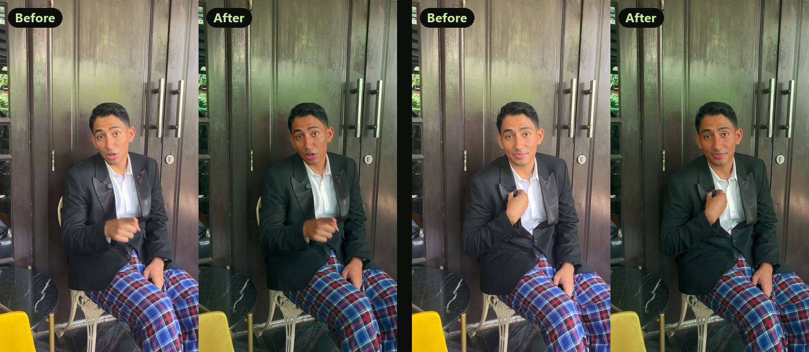
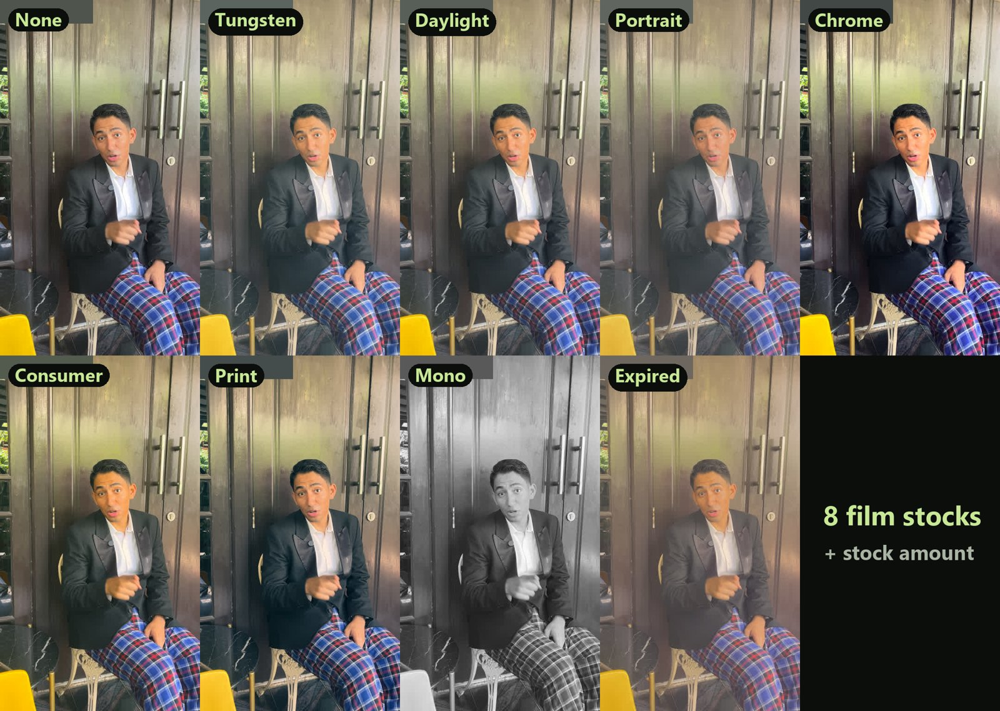
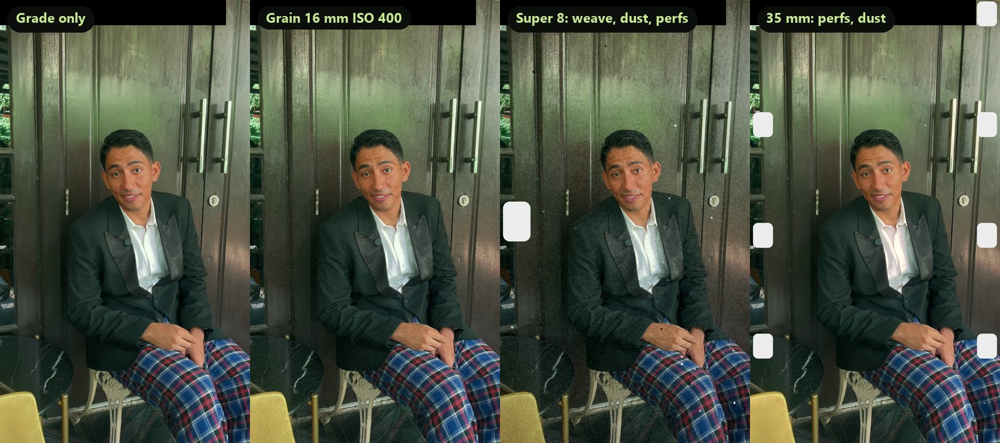

<p align="center"></p>

<p align="center"><a href="https://github.com/jordylf/OdyGrade/releases/latest"><strong>Download for Windows ↗</strong></a> &nbsp; · &nbsp; <a href="#install">Install</a> &nbsp; · &nbsp; <a href="docs/COLOR-MANAGEMENT.md">Color profiles</a> &nbsp; · &nbsp; <a href="docs/STATUS.md">Status</a> &nbsp; · &nbsp; <a href="docs/DEVELOPMENT.md">Development</a></p>

OdyGrade grades your footage to look like a reference still, right inside **After Effects** and **Premiere Pro 2024**. Pick a frame, drop in a film still you love, press **Create grade**, then fine-tune looks, film stocks, grain and halation. All of it runs in a native effect on your timeline.

**Current release: [0.5.1](https://github.com/jordylf/OdyGrade/releases/tag/v0.5.1)** · Windows x64 · live-tested in After Effects 24.6 and Premiere Pro 24.6.

## Match a reference, keep it editable

<p align="center"><br><sub>The OdyGrade panel at docked size · synthetic sample frames</sub></p>

The panel measures tone, palette and chroma in your frame and the reference, then freezes them into one grade. That grade is used for every frame of the shot, so there is no frame-to-frame pumping. **Skin hue protection** keeps faces from drifting toward the reference palette.

Everything stays editable: match strength, exposure / white-balance trims, contrast, saturation, faded blacks and highlight softness. The grade is embedded in the effect, so it survives save, reopen and render (Media Encoder included).

- **Apply to selected clips:** puts the effect and grade on every selected layer or clip in one undo step.
- **Save .odyn / Open:** reuse a grade on other shots and projects.
- **Export .cube:** a colour-only LUT for other apps.
- **Ten original looks:** Neutral, Amber Hour, Nocturne, Evergreen, Rose Memory, Silver Screen, Coastal Blue, Earth & Ochre, Cyan District, Velvet Night.

## Film stocks

<p align="center"><br><sub>Same frame, each stock at 100% · real iPhone footage</sub></p>

Tungsten, Daylight, Portrait, Chrome, Consumer, Print, Mono and Expired, blended in with **Stock amount**. They are our own colour responses, not copies of any manufacturer's film or LUT.

## Film texture

<p align="center"></p>

- **Grain:** classic pixel grain, or 8 / 16 / 35 / 65 mm gauges with an ISO control.
- **Light:** bloom and halation.
- **Frame:** vignette, bleach bypass, and 1.33 / 1.85 / 2.39 mattes that respect the pixel aspect ratio.
- **Film formats:** Regular 8, Super 8, 16 mm, Super 16, 35 mm and IMAX, with gate weave, flicker, dust and perforations.

Grain moves over time but is deterministic: a frame always renders the same, in any order and with Multi-Frame Rendering.

## Your camera, your profile

Choose the source profile so the match starts from the right encoding:

- **sRGB**, or **Rec.709 gamma 2.4**
- **HLG / Rec.2020** for iPhone HDR video. Use it in After Effects. Premiere tone-maps HLG to Rec.709 by default, so use sRGB there.
- **LOG:** Sony S-Log3, Panasonic V-Log, ARRI LogC3, Canon C-Log3, Fujifilm F-Log, DJI D-Log, Apple Log, Blackmagic Film Gen 5

Output is SDR. See [Color management](docs/COLOR-MANAGEMENT.md) for the curves and limits.

## Fast enough for the timeline

1080×1920 frames with grade, film stock, 35 mm grain, bloom, halation, weave and dust:

| Host | Measured |
| --- | --- |
| After Effects 24.6, 120-frame render | 54.4 s (113.9 s in 0.4) · 61.3 s with trims |
| Premiere Pro 24.6, JPEG sequence export | 0.26 s per frame (0.07 s without the effect) |

The effect does the whole grade in one pass and shares the CPU between frames that AE renders at the same time (Multi-Frame Rendering).

## Install

1. Download **OdyGrade-0.5.1-win64.zip** from the [latest release](https://github.com/jordylf/OdyGrade/releases/latest) and extract it.
2. Close After Effects and Premiere Pro.
3. Run **Install.cmd**. It asks once for administrator rights to copy the effect, and checks its SHA-256.
4. Open **Window › Extensions › OdyGrade**. The effect is in **Video Effects › OdyWorks › OdyGrade**.

**Uninstall.cmd** removes both. The panel is unsigned, so the installer turns on CEP debug mode (`PlayerDebugMode`, CSXS.11) for your user; a previous panel is moved to `%LOCALAPPDATA%\OdyGrade\backup`.

## Build & verify

Node 18+, CMake 3.20+, Visual Studio 2022 Build Tools and the After Effects SDK:

```powershell
npm test                                       # JS engine, profiles, panel, version (68 tests)
node tools/native.cjs build                    # portable C++ core + offline renderer
node tools/adobe.cjs --sdk <AfterEffectsSDK>   # OdyGrade.aex + adapter tests
npm run release                                # ../OdyGrade-<version>-win64.zip
```

Host checks run only in an empty Untitled project or in scratch projects; they never close or replace an open project. Results and limits: [Status](docs/STATUS.md) · [Verification](docs/VERIFICATION.md) · [Development notes](docs/DEVELOPMENT.md).

## Limits

- Windows only, not yet tested on a clean machine. No signed ZXP.
- SDR output. Values above 1.0 are clipped in AE 32 bpc and untested in Premiere.
- LOG profiles are checked against their published curves, not yet with real camera footage.
- Matching is statistical (tone, palette, chroma), not a trained model; skin protection is a colour heuristic.

No looks, presets, LUTs or code from other grading products are included; all look and stock names and parameters are original. [Third-party notices](THIRD_PARTY_NOTICES.md).
